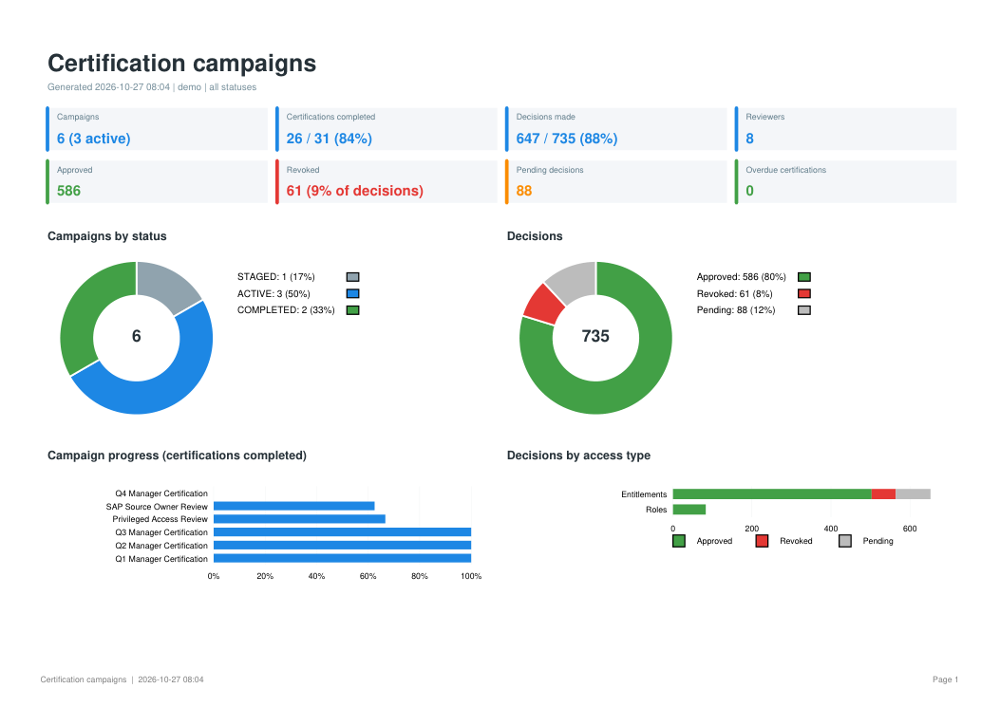
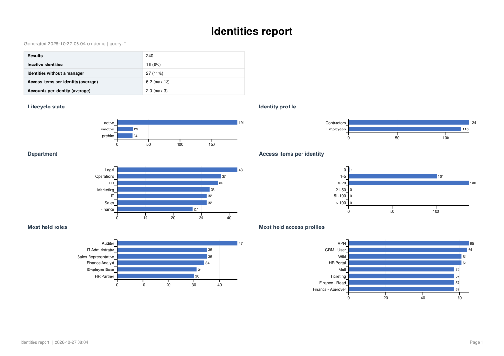
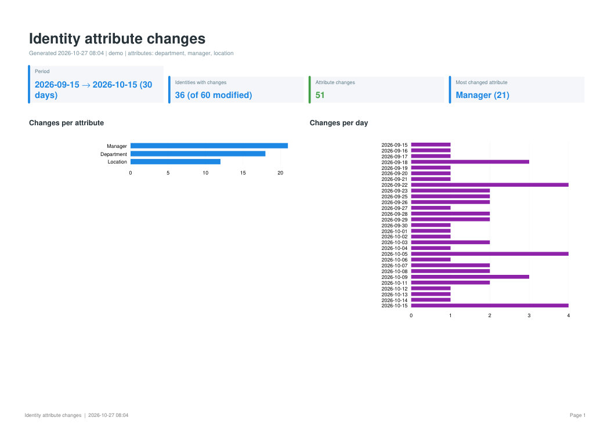
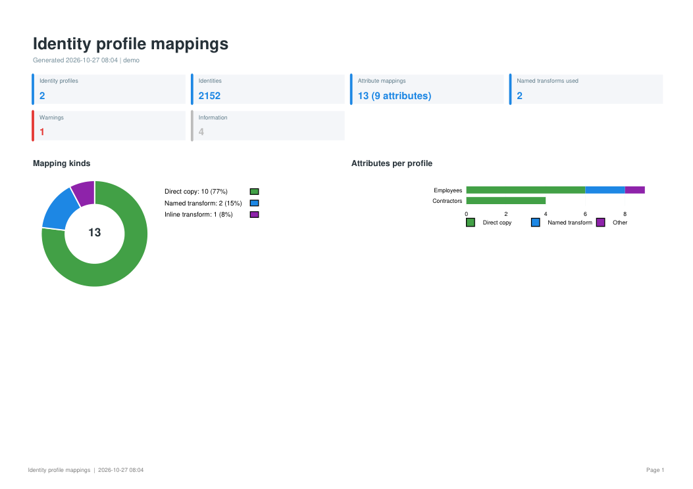
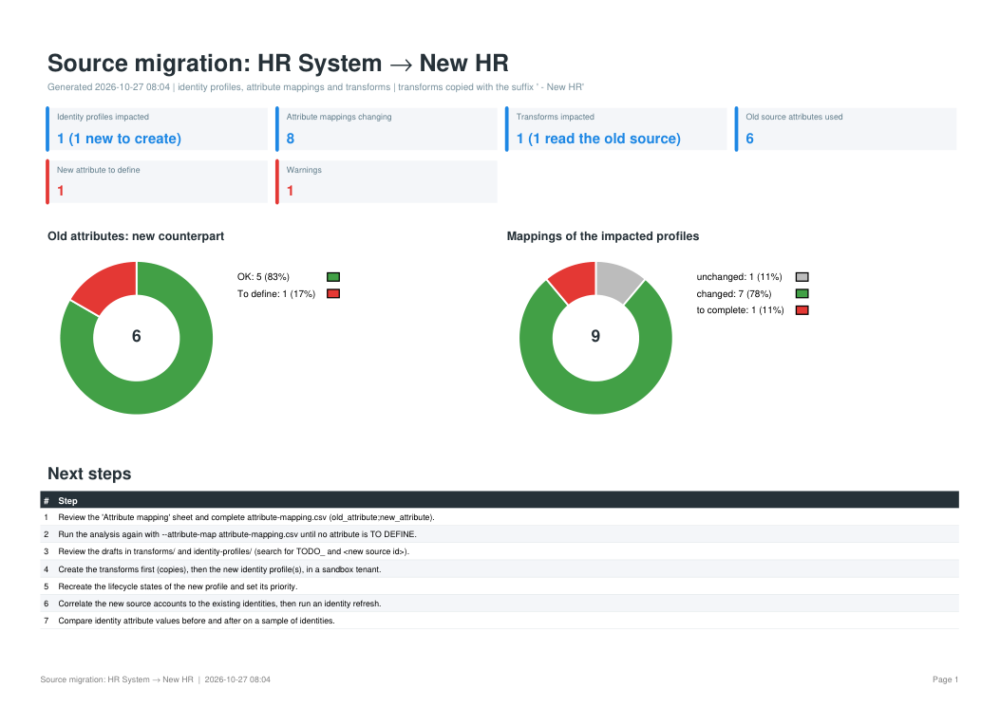

# isc-reporter

[](https://pypi.org/project/isc-reporter/)
[](https://pypi.org/project/isc-reporter/)
[](https://github.com/NDIAYE-baoussou/isc-reporter/actions/workflows/ci.yml)
[](https://github.com/NDIAYE-baoussou/isc-reporter/blob/main/LICENSE)

Reports and change-impact analysis for **SailPoint Identity Security Cloud (ISC)**, from the
command line. `isc-reporter` turns what your tenant holds into Excel dashboards (KPI tiles, native
charts, filterable tables), PDF and CSV files people can read, and shows what a configuration
change would do before you make it. It only reads from the tenant.



> isc-reporter is a community project. It is not affiliated with, endorsed or supported by
> SailPoint Technologies. SailPoint and Identity Security Cloud are trademarks of SailPoint
> Technologies, Inc.

## What it helps with

- **See what ISC holds.** Identities with their roles, access profiles, entitlements and accounts
  on one line each, certification progress and reviewer workload, attribute changes with their old
  and new values, the status of every source and how ISC provisions it. *For IAM operations,
  managers and auditors.*
- **Understand the configuration.** How every identity attribute is computed, in plain words,
  where else it is used (transforms, provisioning policies), how the named transforms depend on
  each other, what is broken, risky or repeated in the transforms with optimized drafts, and checks
  for likely mistakes. *For ISC engineers and architects.*
- **Change safely.** Before replacing a source, enabling attribute synchronization or enabling a
  role, see what would be impacted, updated or provisioned, with draft JSON to review. *For
  implementation teams and consultants.*
- **Keep audit evidence.** Every certification decision with its reviewer comment, attribute
  change history, the query behind each report, and snapshots of the configuration whose history
  shows what changed and when, in files you can archive. *For audit and compliance.*

## Commands

| Command | What you get | Output | Maturity |
| --- | --- | --- | --- |
| `search` | Any search (identities, access profiles, roles, entitlements, events, account activities, workflows) with **one line per object**: an identity's roles, access profiles, entitlements and accounts are consolidated instead of repeated on many lines. | xlsx, pdf, csv | Beta |
| `campaigns` | Certification campaign dashboard: progress, approved / revoked / pending decisions by access type, reviewer workload, overdue certifications, and every reviewed item for audit evidence. | xlsx, pdf | Beta |
| `changes` | Identity attribute changes **with old and new values** over a period (e.g. department and manager changes of the last 30 days), which ISC search cannot show. | xlsx, pdf, csv | Beta |
| `sources` | Status and capabilities of every source: health and virtual appliance cluster, **how ISC provisions it** (its connector, a service desk integration or manual work items), features (provisioning, enable / disable, passwords, unlock...), provisioning policies, account correlation, attribute synchronization, aggregation schedule and last aggregation, accounts and uncorrelated accounts, with checks. | xlsx, pdf, csv | Experimental |
| `mappings` | How every identity attribute is built, profile by profile: source, account attribute, transforms, a plain-language explanation, where else the attribute is used, and checks for likely mistakes; how the named transforms depend on each other, as trees and as an interactive map; what each lifecycle state provisions, source by source. | xlsx, pdf, interactive html | Beta |
| `transforms` | Transform analysis: what is broken (missing or looping transforms), risky (lookup without default, identity attributes read in profile mappings), repeated (duplicates, same logic for other inputs, copies, blocks in several places), unused, too complex or recomputed every night for nothing, following SailPoint's transform guidance, with **optimized JSON drafts** of the changes that give the same result, and an **optimization plan for the whole tenant**: named transforms before and after, transform steps per identity profile. | xlsx, pdf, JSON drafts | Experimental |
| `migration` | Impact of replacing a source (a new HR system, or any other), even when the new one is not chosen yet: everything that depends on it, with what to do for each object. Identity profiles, identity attributes, transforms and mappings before / after, roles, access profiles, SoD policies, lifecycle states, correlation, provisioning policies, segments, workflows, connector rules and password policies, with draft JSON once the new source is known. | xlsx, pdf, csv, JSON drafts | Beta |
| `analyze-before-sync` | Forecast of the updates ISC could send to a target system if attribute synchronization is enabled on a source: values added, changed or cleared, per attribute and per account. | xlsx, pdf, csv | Experimental |
| `leavers` | Identities in a leaver lifecycle state that still have enabled accounts, and for each account whether the lifecycle state should have disabled it (a failure to fix) or does not cover it (a configuration gap). | xlsx, pdf, csv | Beta |
| `role-impact` | Before enabling a role: the identities its membership criteria select, the entitlements ISC would provision to them and the accounts it would create, who would lose the role, and who already holds its access without matching. Works on a draft role with new criteria too. | xlsx, pdf, csv | Experimental |
| `snapshot` | Configuration snapshot: transforms, identity profiles with their lifecycle states, identity attributes, sources with their schemas, provisioning policies and correlation, roles, access profiles, segments, connector rules, workflows, SoD policies, governance groups and password policies, **one JSON file per object**, secrets redacted. Taken again into the same folder, only what changed in the tenant changes: keep it under git for the history of the configuration. Reports run on it with `--from`. | JSON files | Experimental |
| `demo` | Every report above, built from fictional data, without a tenant. | all of the above | |
| `env` | Tenant environments: one per tenant (dev, sandbox, prod), switched with `env use` or `--env`; the client secret is kept in the credential store of the computer, never in a file. See [Configuration](#configuration). | | Beta |

**Beta**: documented and covered by automated tests; needs validation on more real tenants.
**Experimental**: new; its results rest on assumptions still to be confirmed on real tenants, and
may change. A command becomes **Stable** once it has been used on several real tenants without
open issues.

## Quick start

You need Python 3.10 or later.

1. **Install**

   ```bash
   python -m pip install isc-reporter
   ```

2. **Try it without a tenant.** This writes every report, built from fictional data, to
   `outputs/demo/`:

   ```bash
   isc-reporter demo
   ```

3. **Connect to your tenant.** Create a
   [personal access token](https://documentation.sailpoint.com/saas/help/common/api_keys.html)
   with [the permissions of the commands you will use](https://github.com/NDIAYE-baoussou/isc-reporter/blob/main/docs/permissions.md),
   then save it as an environment. The client secret is asked for, not shown, and kept in the
   credential store of your computer (Windows Credential Manager, macOS Keychain), never in a file:

   ```bash
   isc-reporter env add prod --url https://<tenant>.api.identitynow.com --client-id <client id>
   ```

4. **Run a first report**

   ```bash
   isc-reporter search identities
   ```

`iscr` is a short name for the same command: `iscr demo` works too. If the command is not found, or
is blocked by an application control policy (common on managed Windows computers), run it through
Python instead: `python -m iscr demo` (`py -m iscr demo` on Windows).

## Configuration

### Environments: one per tenant

```bash
isc-reporter env add sandbox --url https://acme-sb.api.identitynow.com --client-id <id>   # secret asked for
isc-reporter env add prod --url https://acme.api.identitynow.com --client-id <id> --use
isc-reporter env list                     # * marks the current one
isc-reporter env use sandbox              # commands now run on the sandbox
isc-reporter mappings --env prod          # one command on another tenant
isc-reporter env test prod                # check that it connects
isc-reporter env remove sandbox
```

An environment keeps the tenant URL and the client ID in `environments.json`, in your user profile
(`%APPDATA%\isc-reporter` on Windows), and the client secret in the credential store of the
computer: Windows Credential Manager, the macOS Keychain or the Secret Service on Linux. The secret
is never written to a file or shown, and `env add` checks it against the tenant before saving it.
For scripts, `--secret-stdin` reads it from standard input instead of asking for it.

Credentials are taken from the first of:

1. `--env NAME`, or the `ISCR_ENV` variable;
2. the `SAIL_BASE_URL`, `SAIL_CLIENT_ID` and `SAIL_CLIENT_SECRET` environment variables
   (`SAILPOINT_*` also work), for pipelines and computers without a credential store;
3. the current environment (`env use`).

The log says which one was used (`Connected to https://... (environment 'prod')`).

**From config.json.** A `config.json` holds the client secret in clear text, where it is easy to
forget, copy or share. It is still read, with a warning, when nothing above applies (and `--config`
still names one), but this will be removed. Move it into an environment and delete it in one go:

```bash
isc-reporter env import config.json --name prod --delete
```

Every command writes its reports to `outputs/` (change with `--output-dir`, or name the file with
`-o`) and its log to `logs/` (`--log-dir ""` turns it off), and accepts `--format` (`xlsx`, `pdf`,
`csv` where it makes sense, and `html` for `mappings`). `isc-reporter <command> --help` lists every
option.

## Safety, permissions and privacy

- **Read-only.** isc-reporter only reads from your tenant: it never creates, changes or deletes
  anything. `migration` and `transforms` write draft JSON to local files for you to review,
  `analyze-before-sync` forecasts updates without sending any, `role-impact` evaluates a role's
  criteria without assigning it, and `snapshot` saves the configuration without restoring anything.
- **Offline where it can be.** `demo`, `mappings --from`, `transforms --from` and `migration --from`
  use fictional data, exported JSON files or a snapshot, and never connect.
- **Least privilege.** [docs/permissions.md](https://github.com/NDIAYE-baoussou/isc-reporter/blob/main/docs/permissions.md)
  lists the endpoints, scopes and user levels each command needs, so the token can have no more
  than that.
- **Credentials.** The client secret of an environment is kept in the credential store of the
  computer, never in a file; pipelines can use environment variables. isc-reporter never writes
  credentials to its logs or reports, and warns when it reads a `config.json`. Snapshots replace
  the secrets of the configuration (passwords, tokens, client secrets, encrypted connector
  attributes) by `(redacted)`.
- **Personal data.** Reports contain names, emails and access. `.gitignore` keeps `outputs/`,
  `logs/`, spreadsheets and PDFs out of version control; handle reports under your organisation's
  data protection rules, and never attach real reports to public issues.
- **Load on the tenant.** Searches are paged past the 10,000-result limit, and throttled calls are
  retried after the delay ISC asks for. Commands that make one call per identity or certification
  have options to narrow them: see
  [load on the tenant](https://github.com/NDIAYE-baoussou/isc-reporter/blob/main/docs/permissions.md#load-on-the-tenant).

## Command reference

### Search reports



```bash
isc-reporter types                                        # available report types
isc-reporter search identities
isc-reporter search identities -q "attributes.department:Finance" --expand access
isc-reporter search entitlements -q "privileged:true" --format xlsx csv
isc-reporter search events -q "status:FAILED AND created:[now-7d TO now]"
isc-reporter search identities --columns displayName,email,attributes.location --group-by attributes.location
```

| Type                   | One line per       | Consolidated into the line                                    | `--expand` (one line per item)   |
| ---------------------- | ------------------ | ------------------------------------------------------------- | ---------------------------------- |
| `identities`         | identity           | roles, access profiles, entitlements, accounts (list + count) | `access`, `accounts`, `apps` |
| `access-profiles`    | access profile     | entitlements                                                  | `entitlements`                   |
| `roles`              | role               | access profiles, entitlements                                 | `access-profiles`                |
| `entitlements`       | entitlement        |                                                               |                                    |
| `events`             | event              |                                                               |                                    |
| `account-activities` | activity           | account requests                                              | `account-requests`               |
| `workflows`          | workflow execution |                                                               |                                    |

The workbook has a *Summary* (key figures and a chart per breakdown), the *Data* as an Excel
table, a *Detail* sheet with `--expand`, and the *Query* used. Any other search index works too,
with columns chosen automatically or with `--columns`. Reports can be saved as JSON and shared:
see [`examples/reports/`](https://github.com/NDIAYE-baoussou/isc-reporter/tree/main/examples/reports)
and `--definition`.

### Certification campaigns

```bash
isc-reporter campaigns                                    # every campaign
isc-reporter campaigns --status ACTIVE
isc-reporter campaigns --since 2026-01-01 --items         # with every reviewed access item
isc-reporter campaigns --campaign "Q3 Manager Certification" --format pdf
```

Sheets: *Dashboard*, *Campaigns* (progress bars, revocation rate, days left), *Certifications*
(one per reviewer), *Reviewers* (workload, most pending first), with `--items` *Identities*
(access grouped by decision) and *Decisions* (every item with its reviewer comment), and
*Filters*. Overdue items are shown in red. Role composition campaigns are listed with their
progress but have no reviewer detail (their reviews are not identity certifications).

### Identity attribute changes



```bash
isc-reporter changes --attributes department,manager --days 30 --format xlsx pdf csv
isc-reporter changes --since 2026-10-01 -q "attributes.cloudLifecycleState:active"
isc-reporter changes --exclude someDailyAttribute
```

ISC search does not keep previous attribute values, so this report finds the identities modified
in the period and reads their history. *By identity* gives one line per identity with
`Old <attribute>` / `New <attribute>` columns; *Changes* lists every change. Manager ids are
shown as names. Attributes that change on most days (typically computed from today's date by a
transform) are flagged, as they fire an attribute change event every day. One history call is
made per modified identity: narrow large tenants with `--query` or `--max-identities`.

### Source status and capabilities

```bash
isc-reporter sources
isc-reporter sources --source "Active Directory" --source "SAP*"
isc-reporter sources --quick                       # the source list only: one call
```

One line per source: type and connector, direct or file connection, authoritative or not,
**health** (its status and the date of the last health check) and the status of its virtual
appliance cluster. **How ISC provisions it**: through its connector (the PROVISIONING feature), a
service desk integration (tickets), manual work items for the source owner, or not at all for an
authoritative source it only reads; whether it can enable and disable accounts, change passwords
and unlock accounts. Then its features, provisioning policies (CREATE, UPDATE...), before
provisioning rule, account and manager correlation, attribute synchronization, aggregation
schedule, last account aggregation and its result, accounts and uncorrelated accounts, delete
threshold and owner.

The checks flag a source or cluster in error, a failed last aggregation, a source not aggregated
for more than `--stale-days` days (7 by default) or without a schedule, no account correlation,
uncorrelated accounts, a delete threshold of 50% or more (a warning on an authoritative source),
and a source that can provision without an account create policy. Sheets: *Dashboard*, *Checks*,
*Sources*, *Features* (one column per connector feature), *Provisioning policies* (with their
fields), *Attribute sync* (each identity attribute, the account attribute it goes to, and whether
it is synchronised), *Clusters* and *Settings*. The CSV holds the *Sources* sheet.

The details of each source take about seven calls per source; `--quick` reads only the source
list. What the token may not read is listed in *Settings*, and the rest of the report is still
produced. The connection settings of the sources, where their credentials are kept, are left out
of the report.

### Identity attribute mappings



```bash
isc-reporter mappings
isc-reporter mappings --profile Employees --profile Contractors
isc-reporter mappings --from exports/            # offline, from exported JSON
```

(`identity-profiles` and `profiles`, its former names, still work with a warning.)

One sheet per profile with, for every identity attribute, the mapping kind, a plain-language
explanation (*"Value of 'hireDate' from HR System, converted by the transform 'Date to ISO8601'
(changes a date format)"*), sources, transforms and the definition. Also: a matrix comparing
profiles, attribute coverage, the transforms used, and checks: required or common attributes not
mapped, missing transforms, lifecycle state copied as is, identical mappings, other sources.
`--from` reads a profile, a list of profiles or a configuration export, with transforms found in
the same files.

For every identity attribute the report also shows where else it is used, in the *Also used in*
column of each profile sheet and in two sheets: *Attribute usage* (one line per attribute: the
profiles that map it, the mappings and named transforms that read it, the source provisioning
policies that use it, and which sources) and *Usage detail* (one line per use). Provisioning
policies are read from every source of the tenant (a source that cannot be read is skipped with a
warning), or from a source export given to `--from`. Identity attributes used in rules (code)
cannot be detected.

**How the named transforms depend on each other.** The *Transform dependencies* sheet draws one
tree per identity attribute that uses a named transform: below it, what it depends on, down to the
last transform. Only named transforms and the identity attributes linking them appear, not what
happens inside each transform. A transform *calls* another one; an identity attribute *uses* a
transform; a transform *reads* an identity attribute, itself computed by other transforms. The
named transforms that nothing uses come last. Each tree folds with the + and - buttons of Excel,
and the PDF has the same trees.

```text
email                              identity attribute (Employees, inline transform)
└─ uses: Build email               lower: converts to lower case
   ├─ reads: firstname (Employees) identity attribute (Employees, named transform)
   │  └─ uses: Normalize name      normalizeNames: normalizes person names
   │     └─ calls: Clean name      trim: removes surrounding spaces
   │        └─ calls: Remove accents   decomposeDiacriticalMarks: removes accents
   └─ reads: lastname (Employees)  identity attribute (Employees, named transform)
      └─ ...
```

The *Transforms* sheet lists every named transform, used or not, with the transforms it calls,
those that call it, what it depends on and its definition.

**What each lifecycle state provisions.** The *Lifecycle states* sheet lists the lifecycle states of
each profile and what happens when an identity enters one: the accounts enabled, disabled or deleted
and on which sources (all sources, with exceptions, or a list), the access profiles granted, whether
all access is removed, who is notified, and how many identities are in it. *Lifecycle by source*
turns it around: one line per source, one column per state, with Enable, Disable or Delete. The
*Checks* sheet adds what is likely wrong: a value the `cloudLifecycleState` mapping can return that
is not a state of the profile or is disabled, a leaver state (inactive) that removes nothing, a
disabled state that still holds identities, and sources or access profiles that no longer exist.
With `--from`, the states a profile export lists (`lifecycleStates`) are used.

`mappings.html` shows the same as an interactive map, in any browser and without internet access:
every named transform and the identity attributes that link them, each one after what it depends
on. Click a transform (or find it with the search) to light up everything it depends on and
everything that depends on it, and *Only its chain* to see nothing else; the panel lists what it
calls, what calls it, the attributes it reads and uses it, and its definition. From there, *Show its
steps* and the *Attribute details* tab draw how one transform or one identity attribute computes
its value, step by step down to the account attributes. Zoom, move, and save any diagram as an SVG
image for a design document. `--format` chooses the files (`xlsx pdf html` by default).

### Transform analysis and optimized drafts

```bash
isc-reporter transforms
isc-reporter transforms --from exports/                # offline, from exported JSON
isc-reporter transforms --no-drafts --format xlsx      # the report only
```

Analyses every place a transform is defined: the named transforms, the identity profile mappings
and the fields of the provisioning policies, following
[SailPoint's guidance on transforms](https://developer.sailpoint.com/docs/extensibility/transforms/).
Each finding has a severity, the place (down to the step inside the transform), why it matters and
what to do:

- **Broken**: a reference to a transform that does not exist or names none, transforms calling each
  other in a loop.
- **Risky**: a lookup without `default` (SailPoint returns an error for any other value), an identity
  attribute read within an identity profile mapping (SailPoint advises against it: attributes are
  computed in parallel), a named transform that reads one source but is used by profiles of other
  sources, a comparison with `now` that is not refreshed nightly (to verify), a transform close to
  the 400 KB limit.
- **Bad data**: a `firstValid` that reads data with no fixed value to fall back on.
- **Performance**: `requiresPeriodicRefresh` set on a value that does not change on its own (no
  comparison with today's date, no other identity, no rule): the nightly identity refresh computes
  it again for every identity of the profile, for nothing.
- **Simplify**: duplicate named transforms, transforms that only call another one, transforms that
  apply the same logic to different inputs, inline copies of a named transform, blocks repeated in
  several places, nested `firstValid` or `concat`, choices that are never reached, double case
  changes, a `dateFormat` to the same format.
- **Maintenance**: transforms not used anywhere, complex transforms, rules, logic in Velocity
  templates.

The `optimized` folder holds the transforms, identity profiles and provisioning policies rewritten
with the *Simplify* changes, which give the same result: duplicates and aliases replaced by the
transform they repeat, repeated blocks moved to new `Shared ...` named transforms, nesting
flattened, needless steps removed. `changes.csv` lists every change with the logic before and
after, `delete.csv` the transforms no longer called once the drafts are applied. Nothing is sent to
the tenant: review the drafts, create the shared transforms first, then update the others, and check
a few identities with the identity profile preview. SailPoint's own transforms (`internal`) and
rules are never changed, and fixes that would change a result (adding a default, a fallback) are
only recommended. Forms and workflows are not read: check them before deleting a transform reported
as not used.

**Optimizing the whole tenant.** The *Optimization plan* sheet, first in the workbook and the PDF,
puts the suggestions in the order to apply them, each with its effect: fix the warnings, delete the
transforms not used, replace the duplicates and aliases, keep one transform per logic, share the
repeated blocks, apply the simplifications, remove the needless nightly refreshes, replace the rules
of the identity profiles. It ends with the number of custom named transforms now and after the plan
(*16 now, 11 after these steps* in the demo). Named transforms that differ only by the attribute they read
(`lower` of the AD `mail`, `lower` of the AD `login`...) are listed in *Same logic*: one transform
without `input` serves them all, each identity profile mapping giving its source attribute, or each
reference its `input`. *Cost by profile* counts the transform steps each identity profile runs for
one identity, the named transforms called included, now and with the drafts, and for all its
identities, with the attributes refreshed every night, the rules and the reads of other identities.
These counts are an estimate to compare profiles and measure the drafts, not a measured time; a
configuration snapshot holds no identity counts, so `--from` on a snapshot gives the steps per
identity only. *Complexity* shows where each named transform is used and for how many identities.

### Source migration analysis



```bash
isc-reporter migration --old-source "HR System"                       # the new source is not chosen yet
isc-reporter migration --old-source "HR System" --new-source "New HR"
# complete outputs/source-migration_<ts>/attribute-mapping.csv, then:
isc-reporter migration --old-source "HR System" --new-source "New HR" --attribute-map attribute-mapping.csv
isc-reporter migration --old-source "Active Directory" --from snapshot/  # offline, from a snapshot
```

Lists everything that depends on the source to replace, an HR system or any other, with what to do
for each object. The new source does not need to be known: without `--new-source` the actions say
*the new source*, the attributes in use are listed in `attribute-mapping.csv` to fill in, and no
draft is written.

- *Overview*: for each type of object, how many depend on the old source, how many with a warning,
  and what to do.
- *Impacts*: one line per part of an object that depends on the old source, with its impact and the
  action:
  - **roles and dimensions**: membership criteria on identity attributes computed from the old
    source (if `department` gets new codes, identities gain or lose roles, and their access, at the
    next identity refresh), criteria that read its accounts or entitlements, and the access profiles
    and entitlements of the old source they grant;
  - **access profiles** of the old source, with the roles, dimensions and lifecycle states that
    grant them and their segments;
  - **SoD policies** on its entitlements;
  - **lifecycle states**: those of the identity profile to recreate, and the account actions and
    access profiles that concern the old source;
  - **account and manager correlation**: of the old source, to recreate, and of the other sources
    when they use impacted identity attributes;
  - **provisioning policies** of the other sources: the fields that read the old source, and those
    that read impacted identity attributes (with attribute synchronization, new values are sent to
    the accounts: run `analyze-before-sync`);
  - **segments** whose visibility uses impacted identity attributes;
  - **workflows** and **connector rules** that name the old source, and the rules it runs;
  - **password policies** that cover it.
- *Identity attributes*: those computed from the old source, directly or from another impacted
  attribute, and the objects that use them.
- *Old source*: its configuration to recreate on the new one (connector, owner, correlation, rules,
  provisioning policies, access profiles, entitlements, password policies). Its connection settings
  are left out.

Once the new source is given, each old account attribute is matched to it (mapping file, or same
name in its account schema), every mapping is shown before and after, and draft JSON is written for
the new identity profiles and transforms. Transforms are copied with a suffix so both sources can
run in parallel (`--in-place` to update them instead).

With `--from`, objects are read from the export; a snapshot holds them all, and a type that is
missing is shown as *not analysed*. A snapshot does not hold entitlements, so SoD policies and roles
are checked against the entitlements of the access profiles of the old source only. Rules are found
by the source name or id in their code, a workflow by the same in its definition. The code of cloud
rules cannot be read through the API. Applications, certification campaigns, access request settings,
service desk integrations and saved searches are listed as next steps, not analysed.

### Before enabling attribute synchronization

```bash
isc-reporter analyze-before-sync "Active Directory"
isc-reporter analyze-before-sync "Active Directory" --map location=physicalDeliveryOfficeName
isc-reporter analyze-before-sync "Active Directory" --map-file extra-mapping.csv --only-map
isc-reporter analyze-before-sync "Active Directory" --format xlsx pdf csv --threshold 5
isc-reporter analyze-before-sync "Active Directory" --exclude title,department --exclude "extensionAttribute*"
isc-reporter analyze-before-sync "Active Directory" --exclude-file never-synced.txt
```

(`analyzebeforesync` also works.) Enabling attribute synchronization on a source can send a bulk of
updates to the target system. The command changes nothing: it reads the source's provisioning
policy, finds the fields mapped directly to an identity attribute (ISC only synchronises those),
reads the accounts of the source and the identities they belong to, and counts what ISC could
write: values **added**, **changed**, **cleared** (the riskiest) or changed in **case only**.

`--map IDENTITY=ACCOUNT` (repeatable) and `--map-file` (a CSV with `identity_attribute;account_attribute`)
add comparisons that are not in the policy yet; `--only-map` uses only those; `--usage` reads other
policy usage types than `CREATE`. A verdict (*No update expected*, *Limited updates*, *Bulk update
expected*) is given, a bulk update being flagged when a value would be cleared or when `--threshold`
percent of the accounts (default 10) would be updated.

Attributes that will never be synchronised (switched off in the source's attribute sync settings, or
owned by the target system) can be left out with `--exclude` (repeatable, comma-separated) or
`--exclude-file` (one per line, `#` for comments, handy for a list kept with your project). Give an
account or identity attribute name, with `*` and `?` as wildcards, or an `IDENTITY=ACCOUNT` pair to
leave out one mapping only; case is ignored. Excluded attributes are neither compared nor counted in
the verdict; they are listed in the *Excluded* sheet and in the checks, and a name that matches
nothing is reported, in case of a typo.

Sheets: *Dashboard*, *Attributes* (per mapped attribute: accounts compared, added, changed, cleared,
share, risk), *Accounts* (worst first), *Changes* (current and new value of every update; the CSV has
them all), *Not analysed* (policy fields that are not a direct copy), *Excluded* (with `--exclude`),
*Checks*. Every difference is
counted, as if ISC evaluated all accounts, so read the figures as an upper bound. The *Changes*
sheet contains real attribute values: protect the file.

### Leavers who still have access

```bash
isc-reporter leavers                                       # states configured as inactive
isc-reporter leavers --states inactive gardenLeave inactive30j out
isc-reporter leavers --date-attribute endDate --grace 1 --exclude-source "Payslip Portal"
```

Lists the identities in a leaver lifecycle state that still have enabled accounts. By default the
leaver states are the lifecycle states configured as inactive in the identity profiles; give your
own with `--states`. Disabled accounts and accounts of authoritative sources are left out
(`--include-authoritative` keeps the latter), as are the sources given with `--exclude-source`.

For each enabled account, the lifecycle state's configuration gives the cause: *Should be disabled*
(or *deleted*) means the state should have done it, so provisioning failed, is pending or was
undone; *Not covered by the lifecycle state* means nothing disables accounts of that source, a
configuration gap. With `--date-attribute` (the identity attribute holding the departure date,
ISO 8601, dd/MM/yyyy or yyyyMMdd) the report shows the days since leaving, and with `--grace` the
accounts still enabled after that many days. Sheets: *Dashboard*, *Leavers with access*, *Enabled
accounts* (privileged first), *By source*, *Lifecycle states* (their account actions) and
*Settings*.

### Before enabling a role

```bash
isc-reporter role-impact "Finance Analyst"
isc-reporter role-impact "Finance Analyst" --query 'attributes.cloudLifecycleState:active'
isc-reporter role-impact --from finance-analyst-draft.json      # a draft with new criteria
```

Enabling a role assigns it to every identity its membership criteria select, and ISC provisions
its entitlements to them, creating accounts where needed. The command changes nothing: it reads
the role, the entitlements of its access profiles and its own, every identity (or those matching
`--query`) with its access and accounts, and the accounts of the sources that account criteria
read, then evaluates the criteria for each identity. With `--from`, the role comes from a JSON
file (as the roles API returns it, or a configuration export with the role name given) so that new
criteria can be tested before they are saved.

Each identity concerned gets an outcome: *Gets the role and new access* (the entitlements to
provision, with *new account* when it has none on the source), *Gets the role, access already
held*, *Already has the role*, *Loses the role* (assigned by the criteria, no longer matches them),
*Has the role outside the criteria* (requested), and *Has the access without the role* (holds all
of it without matching: the criteria may be too narrow). Sheets: *Dashboard*, *Identities*,
*Provisioning* (one line per entitlement to provision, privileged first), *Entitlements* (who
holds each one), *By source*, *Role* (its criteria in plain text).

The criteria are evaluated by the command, as ISC is expected to: values compared ignoring case, a
multi-valued attribute matching when one of its values does. On a role already assigned by its
criteria, few *Loses the role* and *Gets the role* lines confirm that the evaluation matches the
tenant. The criteria of dimensions are not analysed.

### Configuration snapshot

```bash
isc-reporter snapshot -o config-history/prod                         # every type
isc-reporter snapshot -o config-history/prod --only transforms identity-profiles
isc-reporter mappings --from config-history/prod                     # a report from it, offline
```

Saves the configuration of the tenant as JSON, one file per object and one folder per type:
`transforms`, `identity-profiles` (with their lifecycle states), `identity-attributes`, `sources`
(with their schemas, provisioning policies and account correlation), `roles` (with the dimensions of
dynamic roles), `access-profiles`, `segments`, `connector-rules`, `workflows`, `sod-policies`,
`governance-groups` and `password-policies`. `snapshot.json` says from which tenant and endpoint each
type was read, when, and what changed since the previous snapshot.

Taken again into the same folder, a snapshot rewrites only the files of the objects that changed,
adds the new ones and removes those deleted in the tenant. Keep the folder under git and its history
is the history of the configuration: `git diff` shows what changed between two snapshots, `git log
-- transforms/` when each transform changed.

```bash
git init config-history/prod                                         # once
isc-reporter snapshot --env prod -o config-history/prod
git -C config-history/prod add -A && git -C config-history/prod commit -m "Snapshot"
```

So that the files only change when the configuration does, keys and lists of references are kept in
a fixed order, and the fields that change on their own are left out: modification dates, identity,
member and execution counts, the refresh flag of identity profiles, source health and aggregation
state. Reports run from a snapshot therefore show no identity counts.

Secrets are replaced by `(redacted)`: passwords, tokens, client secrets and API keys of the sources
and workflows, the connector attributes listed as encrypted, and the static values of password
fields in provisioning policies. Look through the files once before sharing the folder: a secret
kept under an unusual name, in a description for example, cannot be recognised. A snapshot is for
history and comparison, not for restoring: nothing is sent back to the tenant.

The folder must be new, empty (a new git repository is fine) or hold an earlier snapshot of the same
tenant, so that another folder or the snapshot of another tenant is never overwritten. A type that
cannot be read (a scope missing from the token) is reported, and its files from the earlier snapshot
are kept. Cloud rules (their code is not available from the API), forms and notification templates
are not included.

## Roadmap and contributing

[ROADMAP.md](https://github.com/NDIAYE-baoussou/isc-reporter/blob/main/ROADMAP.md) describes where
the project is going; the next milestone is one format for every finding, with JSON output for
automation. Contributions are welcome: a new check or report, test fixtures, documentation, or
simply trying a command on your tenant and telling what you found. See
[CONTRIBUTING.md](https://github.com/NDIAYE-baoussou/isc-reporter/blob/main/CONTRIBUTING.md) and
the [Code of Conduct](https://github.com/NDIAYE-baoussou/isc-reporter/blob/main/CODE_OF_CONDUCT.md).
Report security problems privately, as described in
[SECURITY.md](https://github.com/NDIAYE-baoussou/isc-reporter/blob/main/SECURITY.md). Changes are
listed in [CHANGELOG.md](https://github.com/NDIAYE-baoussou/isc-reporter/blob/main/CHANGELOG.md).

## Development

```bash
python -m venv .venv && . .venv/bin/activate       # Windows: .venv\Scripts\activate
pip install -e ".[dev]"
pytest
ruff check src tests
```

Tests need no tenant: the SDK is replaced by recording fakes and the real SDK models are used to
check what would be read.

## License

[MIT](https://github.com/NDIAYE-baoussou/isc-reporter/blob/main/LICENSE)
