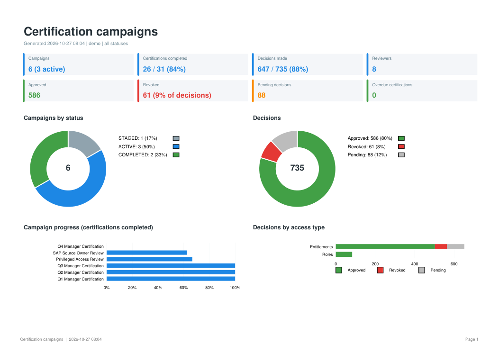
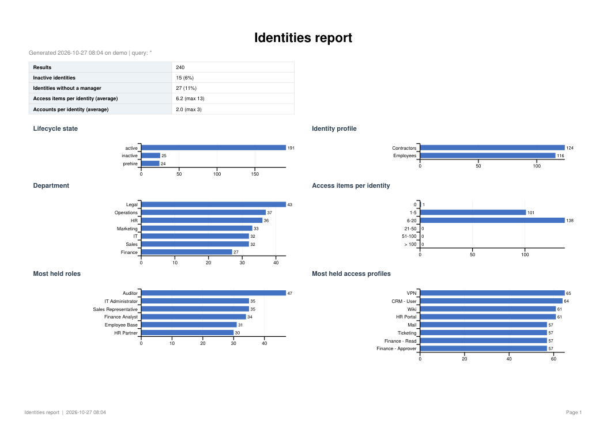
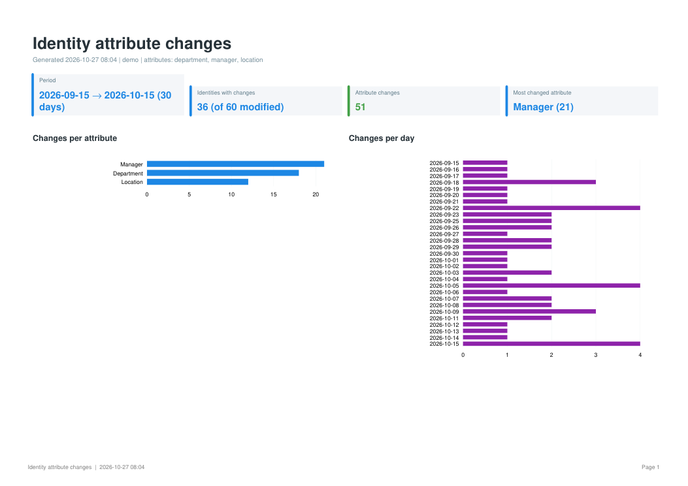
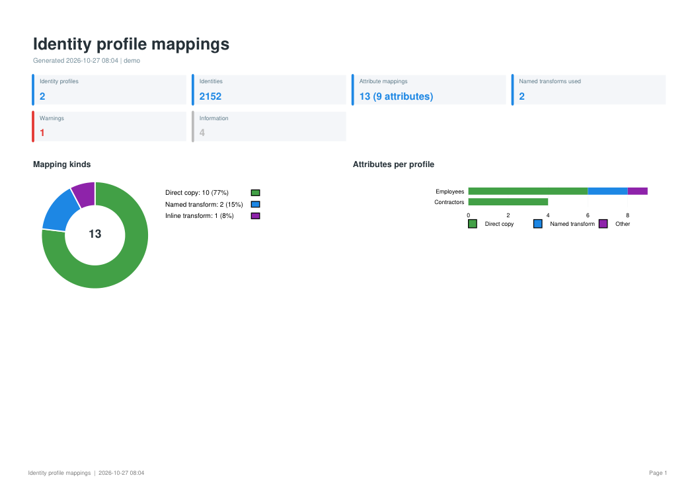
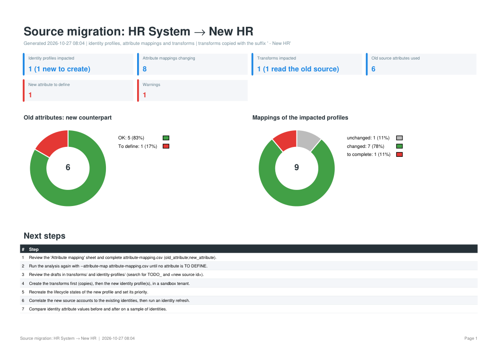

# isc-reporter

Excel dashboards and PDF reports for **SailPoint Identity Security Cloud (ISC)**, from the command line.



`isc-reporter` turns what ISC knows into reports people can read: workbooks with KPI tiles,
native Excel charts and filterable tables, and matching PDF files to send around.

| Command       | What you get                                                                                                                                                                                                                                                 |
| ------------- | ------------------------------------------------------------------------------------------------------------------------------------------------------------------------------------------------------------------------------------------------------------ |
| `search`    | Any search (identities, access profiles, roles, entitlements, events, account activities, workflows) with **one line per object**: an identity's roles, access profiles, entitlements and accounts are consolidated instead of repeated on many lines. |
| `campaigns` | Certification campaign dashboard: progress, approved / revoked / pending decisions by access type, reviewer workload, overdue certifications, and every reviewed item for audit evidence.                                                                    |
| `changes`   | Identity attribute changes **with old and new values** over a period (e.g. department and manager changes of the last 30 days), which ISC search cannot show.                                                                                          |
| `profiles`  | How every identity attribute is built, profile by profile: source, account attribute, transforms, a plain-language explanation, and checks for likely mistakes.                                                                                              |
| `migration` | Impact analysis for replacing a source (typically a new HR system): impacted identity profiles, transforms and attribute mappings, before/after, and draft JSON for the new objects.                                                                         |

**Read-only:** `isc-reporter` only reads from your tenant. It never creates, changes or deletes
anything; the migration analysis writes its drafts to local files for you to review.

> isc-reporter is a community project. It is not affiliated with, endorsed or supported by
> SailPoint Technologies. SailPoint and Identity Security Cloud are trademarks of SailPoint
> Technologies, Inc.

## Install

Python 3.10 or later.

```bash
pip install isc-reporter
```

Or from a clone of this repository: `pip install .`

## Try it without a tenant

```bash
isc-reporter demo
```

writes every report, built from fictional data, to `outputs/demo/`.

## Connect to your tenant

Create a [personal access token](https://documentation.sailpoint.com/saas/help/common/api_keys.html)
for a user who can read what you want to report on, then either set environment variables:

```bash
export SAIL_BASE_URL="https://<tenant>.api.identitynow.com"   # Windows PowerShell: $env:SAIL_BASE_URL = "..."
export SAIL_CLIENT_ID="<client id>"
export SAIL_CLIENT_SECRET="<client secret>"
```

or create a `config.json` in the folder you run from (or pass `--config path/to/file.json`):

```json
{
  "BaseURL": "https://<tenant>.api.identitynow.com",
  "ClientId": "<client id>",
  "ClientSecret": "<client secret>"
}
```

The token needs read access to what each command uses: search (`sp:search:read`) for `search`
and `changes`, identity history (`idn:identity-history:read`) for `changes`, certification
campaigns and certifications for `campaigns`, identity profiles, transforms and identity
attributes for `profiles`, and sources for `migration`.

## Reports

Every command writes to `outputs/` (change with `--output-dir`, or name the file with `-o`),
logs to `logs/`, and accepts `--format xlsx pdf` (plus `csv` where it makes sense).

### Search reports



```bash
isc-reporter types                                        # available report types
isc-reporter search identities
isc-reporter search identities -q "attributes.department:Finance" --expand access
isc-reporter search entitlements -q "privileged:true" --format xlsx csv
isc-reporter search events -q "status:FAILED AND created:[now-7d TO now]"
isc-reporter search identities --columns displayName,email,attributes.location --group-by attributes.location
```

| Type                   | One line per       | Consolidated into the line                                    | `--expand` (one line per item)   |
| ---------------------- | ------------------ | ------------------------------------------------------------- | ---------------------------------- |
| `identities`         | identity           | roles, access profiles, entitlements, accounts (list + count) | `access`, `accounts`, `apps` |
| `access-profiles`    | access profile     | entitlements                                                  | `entitlements`                   |
| `roles`              | role               | access profiles, entitlements                                 | `access-profiles`                |
| `entitlements`       | entitlement        |                                                               |                                    |
| `events`             | event              |                                                               |                                    |
| `account-activities` | activity           | account requests                                              | `account-requests`               |
| `workflows`          | workflow execution |                                                               |                                    |

The workbook has a *Summary* (key figures and a chart per breakdown), the *Data* as an Excel
table, a *Detail* sheet with `--expand`, and the *Query* used. Any other search index works too,
with columns chosen automatically or with `--columns`. Reports can be saved as JSON and shared:
see [`examples/reports/`](examples/reports) and `--definition`.

### Certification campaigns

```bash
isc-reporter campaigns                                    # every campaign
isc-reporter campaigns --status ACTIVE
isc-reporter campaigns --since 2026-01-01 --items         # with every reviewed access item
isc-reporter campaigns --campaign "Q3 Manager Certification" --format pdf
```

Sheets: *Dashboard*, *Campaigns* (progress bars, revocation rate, days left), *Certifications*
(one per reviewer), *Reviewers* (workload, most pending first), with `--items` *Identities*
(access grouped by decision) and *Decisions* (every item with its reviewer comment), and
*Filters*. Overdue items are shown in red. Role composition campaigns are listed with their
progress but have no reviewer detail (their reviews are not identity certifications).

### Identity attribute changes



```bash
isc-reporter changes --attributes department,manager --days 30 --format xlsx pdf csv
isc-reporter changes --since 2026-10-01 -q "attributes.cloudLifecycleState:active"
isc-reporter changes --exclude someDailyAttribute
```

ISC search does not keep previous attribute values, so this report finds the identities modified
in the period and reads their history. *By identity* gives one line per identity with
`Old <attribute>` / `New <attribute>` columns; *Changes* lists every change. Manager ids are
shown as names. Attributes that change on most days (typically computed from today's date by a
transform) are flagged, as they fire an attribute change event every day. One history call is
made per modified identity: narrow large tenants with `--query` or `--max-identities`.

### Identity profile mappings



```bash
isc-reporter profiles
isc-reporter profiles --profile Employees --profile Contractors
isc-reporter profiles --from exports/                     # offline, from exported JSON
```

One sheet per profile with, for every identity attribute, the mapping kind, a plain-language
explanation (*"Value of 'hireDate' from HR System, converted by the transform 'Date to ISO8601'
(changes a date format)"*), sources, transforms and the definition. Also: a matrix comparing
profiles, attribute coverage, the transforms used, and checks: required or common attributes not
mapped, missing transforms, lifecycle state copied as is, identical mappings, other sources.
`--from` reads a profile, a list of profiles or a configuration export, with transforms found in
the same files.

### Source migration analysis



```bash
isc-reporter migration --old-source "HR System" --new-source "New HR"
# complete outputs/source-migration_<ts>/attribute-mapping.csv, then:
isc-reporter migration --old-source "HR System" --new-source "New HR" --attribute-map attribute-mapping.csv
```

Finds the identity profiles authoritative on or reading the old source, the transforms reading
it and those calling them, matches each old account attribute to the new source (mapping file,
or same name in the new account schema), shows every mapping before and after, and writes draft
JSON for the new identity profiles and transforms. Transforms are copied with a suffix so both
sources can run in parallel (`--in-place` to update them instead). Lifecycle states, account
correlation, provisioning policies and workflows are listed as next steps, not analysed.

### Before enabling attribute synchronization

```bash
isc-reporter analyze-before-sync "Active Directory"
isc-reporter analyze-before-sync "Active Directory" --map location=physicalDeliveryOfficeName
isc-reporter analyze-before-sync "Active Directory" --map-file extra-mapping.csv --only-map
isc-reporter analyze-before-sync "Active Directory" --format xlsx pdf csv --threshold 5
```

(`analyzebeforesync` also works.) Enabling attribute synchronization on a source can send a bulk of
updates to the target system. The command changes nothing: it reads the source's provisioning
policy, finds the fields mapped directly to an identity attribute (ISC only synchronises those),
reads the accounts of the source and the identities they belong to, and counts what ISC could
write: values **added**, **changed**, **cleared** (the riskiest) or changed in **case only**.

`--map IDENTITY=ACCOUNT` (repeatable) and `--map-file` (a CSV with `identity_attribute;account_attribute`)
add comparisons that are not in the policy yet; `--only-map` uses only those; `--usage` reads other
policy usage types than `CREATE`. A verdict (*No update expected*, *Limited updates*, *Bulk update
expected*) is given, a bulk update being flagged when a value would be cleared or when `--threshold`
percent of the accounts (default 10) would be updated.

Sheets: *Dashboard*, *Attributes* (per mapped attribute: accounts compared, added, changed, cleared,
share, risk), *Accounts* (worst first), *Changes* (current and new value of every update; the CSV has
them all), *Not analysed* (policy fields that are not a direct copy), *Checks*. Every difference is
counted, as if ISC evaluated all accounts, so read the figures as an upper bound. The token needs read
access to sources, provisioning policies (`idn:provisioning-policy:read`), accounts and search. The
*Changes* sheet contains real attribute values: protect the file.

## Privacy

Reports contain personal data (names, emails, access). The default `.gitignore` keeps
`outputs/`, `logs/`, spreadsheets, PDFs and `config.json` out of version control; handle the
reports under your organisation's data protection rules, and never attach real reports to
public issues.

## Development

```bash
python -m venv .venv && . .venv/bin/activate       # Windows: .venv\Scripts\activate
pip install -e ".[dev]"
pytest
ruff check src tests
```

Tests need no tenant: the SDK is replaced by recording fakes and the real SDK models are used to
check what would be read. See [CONTRIBUTING.md](CONTRIBUTING.md).

## License

[MIT](LICENSE)
